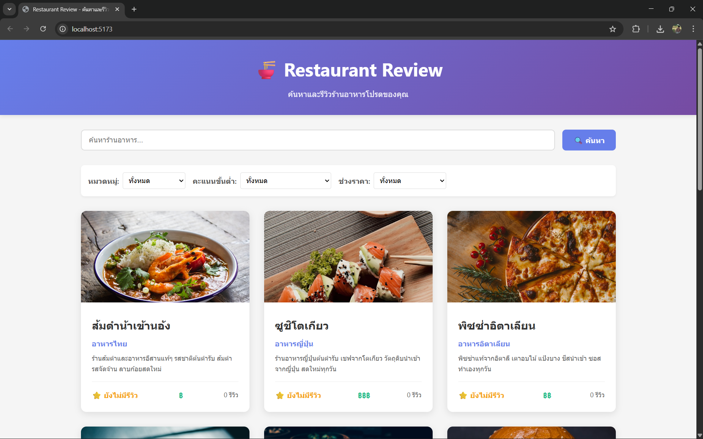
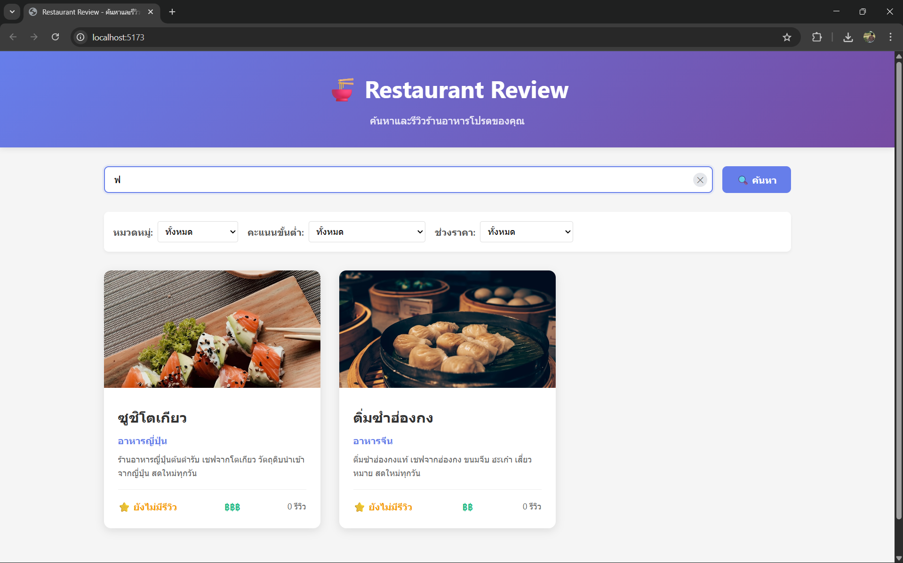
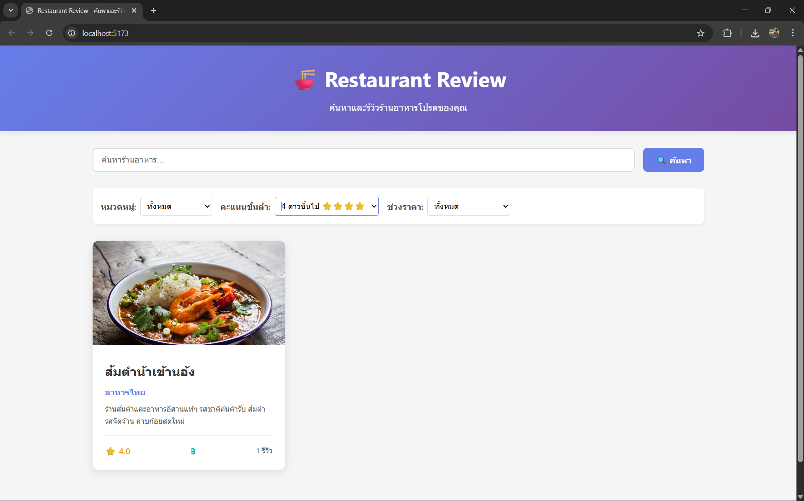
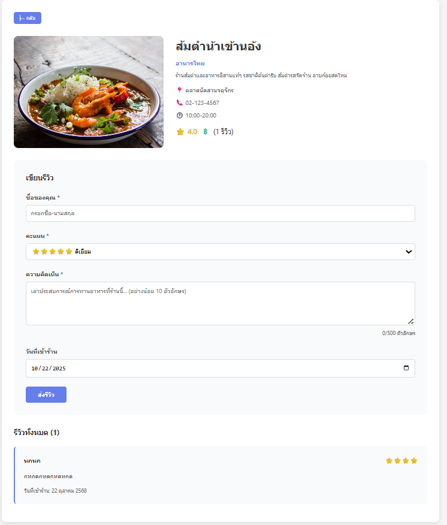
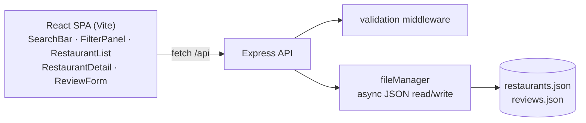

# 🍜 Restaurant Review App

**A full-stack app for discovering and reviewing restaurants: real-time search, category/price/rating filters, restaurant details and validated reviews that update each restaurant's average rating live.**


> Course project for **ENGSE203 Computer Programming for Software Engineers**, RMUTL.



## Features

- **Debounced search as you type** across restaurant names and descriptions
- **Combinable filters:** category, minimum rating and price range
- **Restaurant detail** view with every review, newest first
- **Write a review:** validated on both client and server (name 2–50 chars, rating 1–5, comment length); the restaurant's average rating is recalculated immediately
- **Stats endpoint** for totals, the overall average and the top-rated restaurants

| Search | Filter by rating | Detail and reviews |
|---|---|---|
|  |  |  |

## Architecture



The frontend keeps every API call in `services/api.js`, so components never build URLs themselves. The backend separates routes, validation middleware and file access.

## Run it

```bash
git clone https://github.com/tawan230666/restaurant-review-app.git
cd restaurant-review-app

# API → http://localhost:3000
cd backend && cp .env.example .env && npm install && npm run dev

# Frontend → http://localhost:5173 (new terminal)
cd frontend && npm install && npm run dev
```

## API

| Method | Endpoint | Description |
|---|---|---|
| `GET` | `/api/restaurants` | List restaurants (supports search and filter query params) |
| `GET` | `/api/restaurants/:id` | Restaurant details with its reviews |
| `GET` | `/api/reviews/:restaurantId` | Reviews for one restaurant |
| `POST` | `/api/reviews` | Add a review (validated) and update the average rating |
| `GET` | `/api/stats` | Totals, average rating, top-rated restaurants |

## Next steps

- Replace JSON-file storage with a database to support concurrent writes
- Add authentication so each review is tied to a real user
- Pagination for large result sets

---

**Author:** Tawan Tiphkun (ธาวัน ทิพคุณ), [@tawan230666](https://github.com/tawan230666), Software Engineering, RMUTL Chiang Mai
